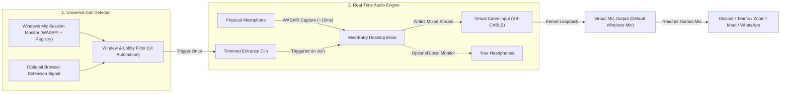

# Future Improvement: Universal MeetEntry Desktop App (Windows)

## 1. Overview & Goal

Expand **MeetEntry** from a Google Meet Chrome extension into a **universal Windows desktop application** that automatically plays a personalized 5–10 second entrance music clip whenever the user joins a call or voice channel in **any** desktop or browser application:

- **Discord** (voice channels & DM calls)
- **Microsoft Teams** (desktop & web)
- **Zoom** (desktop meetings)
- **Google Meet** (Chrome / Edge / Brave)
- **WhatsApp Desktop**, **Slack Huddles**, **Webex**, and optional in-game voice chats

Just like the browser extension, **only the user joining needs the app installed** — other participants hear the entrance music through the normal microphone audio stream without screen sharing or installing anything.

---

## 2. Feasibility Verdict

**Yes — 100% possible as a native Windows desktop app.**

- A **Chrome extension alone cannot do this** because browser extensions are sandboxed inside the browser and cannot access or modify native desktop processes like `Discord.exe`, `Zoom.exe`, or `ms-teams.exe`.
- A **lightweight Windows system-tray application** (built with **Tauri v2 + Rust** and reusing our existing React/TypeScript UI) can achieve universal compatibility using standard Windows Core Audio (`WASAPI`) and OS-level microphone session monitoring — the same foundation used by Voicemod, SteelSeries Sonar, and Soundpad.

---

## 3. System Architecture

The universal desktop app solves two distinct problems without injecting DLLs into target apps (which would trigger anti-cheat or code-signing protections):

1. **Universal Audio Injection** — routing your physical microphone + entrance clip through a Virtual Microphone endpoint.
2. **Universal Call-Join Detection** — detecting the exact moment a target app enters an active call, while filtering out pre-join lobbies and games.

---

## 4. Pillar 1: Universal Audio Routing (Virtual Microphone)

### Why a Virtual Audio Device is Required
Native Windows apps (`Discord.exe`, `Zoom.exe`, `ms-teams.exe`) read audio directly from Windows `WASAPI` capture endpoints. Windows requires a kernel-mode audio driver to expose a virtual microphone endpoint to all applications.

### Driver Options
1. **VB-CABLE (Recommended for V1):**
   - Free, WHQL-signed by Microsoft, works on Windows 10/11 with Secure Boot enabled.
   - Exposes `CABLE Input` (playback endpoint where our app writes mixed audio) and `CABLE Output` (recording endpoint that apps see as a microphone).
2. **Open-Source WaveRT Driver (`VirtualDrivers/Virtual-Audio-Driver` or Microsoft `SYSVAD`):**
   - MIT-licensed WDK virtual audio driver that can be bundled if code-signed in a future commercial release.

### Real-Time Mixing Pipeline
1. **Continuous Mic Pass-Through:**
   - The MeetEntry desktop app opens the user's real hardware microphone in `WASAPI` shared low-latency mode (~10 ms buffer) and continuously forwards it to `CABLE Input`.
   - The user sets `CABLE Output` as their **Default Windows Communications / Recording Microphone** once (or selects it in Discord/Teams/Zoom).
2. **On Call Join:**
   - When the Call Detector fires a `Joined` event, the audio engine mixes the stored 48 kHz mono WAV clip (with fade-in/out envelope and a -3 dBFS brickwall limiter) alongside the live microphone stream into `CABLE Input`.
   - If the user's physical mic is muted (or the app detects host-app mute), playback is skipped or stopped immediately.
   - Optional local monitoring plays the clip to the user's headphones (`ctx.destination` / default playback device) so they can hear their own entrance too.

---

## 5. Pillar 2: Universal Call-Join Detection on Windows

Windows 10/11 natively tracks every process that opens a microphone capture stream — with **zero administrator privileges required**.

### Layer A: OS-Level Microphone Activity Detection
1. **Windows `CapabilityAccessManager` Registry Store:**
   - Path: `HKCU\Software\Microsoft\Windows\CurrentVersion\CapabilityAccessManager\ConsentStore\microphone`
   - Subkeys include both `NonPackaged` desktop apps (e.g., `Discord.exe`, `chrome.exe`, `msedge.exe`, `Zoom.exe`) and packaged Store apps (e.g., `MSTeams_8wekyb3d8bbwe`, `5319275A.WhatsAppDesktop_...`).
   - When an app starts capturing the microphone, Windows sets `LastUsedTimeStart` to the current `FILETIME` and `LastUsedTimeStop = 0`.
   - When the app stops capturing the microphone (call ended), `LastUsedTimeStop` updates to a non-zero timestamp.
   - Can be watched with zero CPU polling via `RegNotifyChangeKeyValue`.
2. **Windows Core Audio Session API (`IAudioSessionManager2`):**
   - Subscribes to `IAudioSessionNotification` / `IAudioSessionEvents` on the capture device.
   - Fires an event within `<50 ms` whenever a process transitions to `AudioSessionStateActive`, exposing the exact process ID (`PID`) and executable path.

### Layer B: Per-App "Pre-Join Lobby" vs. "Actually Joined" Filtering

| Application | Process / Package Name | When Mic Opens | How We Detect "Actually in Call" |
| :--- | :--- | :--- | :--- |
| **Discord** | `Discord.exe` | Only when entering a voice channel or call | Mic session becomes active + ~800 ms delay (so clip plays right after Discord's join chime). Optional Discord local RPC / UI Automation check for Self-Mute / Server-Mute. |
| **WhatsApp** | `WhatsApp.exe` (`5319275A.WhatsAppDesktop*`) | Only when call connects | Mic session becomes active + brief stabilization delay (~600 ms). |
| **Zoom** | `Zoom.exe` | Opens in preview lobby *and* in-call | Mic session active + Windows UI Automation / window check confirming the active `Zoom Meeting` call window (and hang-up/Leave control) is present. |
| **Microsoft Teams** | `ms-teams.exe` (`MSTeams_*`) | Opens in pre-join screen *and* in-call | Mic session active + UI Automation check for the in-call toolbar (`Leave` / `Hang up` button) or Teams' local third-party WebSocket API (`ws://127.0.0.1:8124`). |
| **Google Meet / Web** | `chrome.exe`, `msedge.exe`, `brave.exe` | Opens on pre-join screen *and* in-call | Our existing **MeetEntry Chrome Extension** sends a message to `http://127.0.0.1:<port>/event` on confirmed `joined` state (with fallback to window title / UI Automation if extension is not installed). |
| **Games (Excluded by Default)** | `VALORANT-Win64-Shipping.exe`, `Marvel-Win64-Shipping.exe`, etc. | Opens when game launches or match starts | Ignored by default via the **Target Apps allowlist** so launching a game never accidentally triggers entrance music. |

---

## 6. Key Challenges & Mitigations

### 1. AI Noise Cancellation (Krisp in Discord, Voice Isolation in Teams/Zoom)
- **Problem:** Discord (Krisp), Teams, and Zoom use AI voice-isolation models trained to strip out background music and non-speech audio. If enabled on the receiving or sending client, entrance music can be muffled or suppressed after ~1 second.
- **Mitigation:**
  1. Guide the user in the app's onboarding wizard to disable Krisp / set noise suppression to "Low / Standard" for the virtual microphone in Discord/Zoom/Teams.
  2. Integrate lightweight speech noise suppression (`nnnoiseless` / `RNNoise` in Rust) on the **physical microphone input *before* mixing the entrance clip** — keeping the user's room noise clean while sending the music clip through untouched.

### 2. Respecting Mute State Across Apps
- **Problem:** A user might join a Discord voice channel while already Self-Muted, or join Zoom/Teams muted.
- **Mitigation:**
  - Check physical mic hardware mute + Windows endpoint mute state.
  - Inspect the active meeting app's mute button state via Windows UI Automation (reading the accessible `Name` / `ToggleState` of the Mute button in Discord, Teams, and Zoom) and our browser extension's WebRTC track check for Google Meet.
  - Provide a **Global Emergency Stop Hotkey** (e.g., `Ctrl+Shift+M`) that works even when another app or full-screen window is focused.

### 3. Virtual Cable Setup Friction
- **Problem:** Manually configuring Windows input/output devices can confuse users.
- **Mitigation:**
  - Build a 1-click **"Setup Audio Route"** health check inside the desktop app that:
    - Detects whether `VB-CABLE` is installed (and offers a direct 1-click installer if missing).
    - Lets the user pick their real physical microphone from a dropdown.
    - Verifies that `CABLE Input` and `CABLE Output` are active and running at 48 kHz.

---

## 7. Code Reuse from Current Chrome Extension

Moving to **Tauri v2 (Rust + React/TypeScript/Vite)** lets us reuse ~80% of the existing codebase:

- **Directly Reusable (`src/`):**
  - `src/popup/App.tsx` and all UI components (`AudioDropzone.tsx`, `Waveform.tsx`, `Controls.tsx`, `MeetStatusPanel.tsx`, `PlaybackControls.tsx`, `ui.css`)
  - `src/audio/clipProcessor.ts` and `src/audio/envelope.ts` (WAV encoding, trimming, peak calculation, fade envelopes)
  - The Chrome extension itself (`src/content/`, `src/injection/`) as an optional companion bridge for browser-based meetings
- **New Native Layer (`src-tauri/` in Rust):**
  - `audio_engine.rs` — `cpal` / `wasapi` physical mic capture, ring buffer, WAV clip mixer, and limiter outputting to `CABLE Input`.
  - `call_detector.rs` — Windows Registry watcher (`ConsentStore\microphone`), `IAudioSessionManager2` listener, and UI Automation lobby filter.
  - `tray.rs` — System tray icon, quick Mute/Stop menu, and global hotkeys (`tauri-plugin-global-shortcut`).

---

## 8. Phased Implementation Roadmap

1. **Phase 1 — Tauri Desktop Shell & UI Port:**
   - Initialize `src-tauri/` alongside the existing Vite + React frontend.
   - Add system tray support, window persistence, and per-app enable/disable toggles (`Discord`, `Teams`, `Zoom`, `Browsers`, `WhatsApp`).
2. **Phase 2 — Native WASAPI Audio Mixer & Virtual Cable Routing:**
   - Implement physical mic -> `CABLE Input` real-time pass-through in Rust.
   - Add WAV clip mixing with fade-in/out, volume control, limiter, and optional local speaker monitoring.
   - Add virtual cable detection and setup wizard.
3. **Phase 3 — Universal Windows Call Detector:**
   - Implement `ConsentStore\microphone` + `IAudioSessionManager2` watcher.
   - Add per-app lobby filters (Discord delay, Zoom/Teams in-call UI check, localhost webhook from the MeetEntry Chrome extension).
4. **Phase 4 — Pre-Mix Noise Gate / RNNoise & Global Hotkeys:**
   - Add optional `RNNoise` voice cleanup on the physical mic channel before mixing the entrance clip (so users can safely disable Krisp in Discord).
   - Add global hotkeys for Replay and Emergency Stop.
